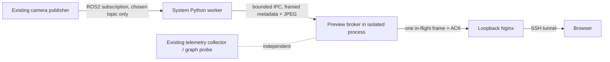

# Native camera worker design — proposed, not implemented

The future preview worker is a separate, short-lived `/usr/bin/python3` process with native ROS2/TogetheROS libraries. The isolated application venv must never import `rclpy`, sensor messages or vendor packages. Existing graph discovery stays unchanged. Start the worker only on explicit preview activation; subscribe only to the chosen already-published topic, and stop subscriptions and reap the worker on final disconnect, switch, deadline or shutdown. Never start a capture driver or change DDS, ROS domain, service hardening or hardware state. Handle the read-only-home ROS logging constraint with the previously validated logging option, without changing the service namespace.

The IPC protocol, process privilege boundaries, child resource caps, heartbeat, error handling and lifecycle supervision remain Phase B design/implementation work; the picture is a proposal, not an implemented worker. Reject oversized headers/payloads, malformed messages and unknown encodings before allocation/conversion; cap raw dimensions, stride, output frame, client count, rate and per-client socket time. Keep one latest slot, discard obsolete data and expose counters, timestamp provenance and stale/disconnected status. Never block the telemetry event loop on decode, DDS, subprocess pipes or slow clients. A native process crash, hung subscriber or browser disconnect must not accumulate children or subscriptions. The Phase A 256 KiB bound applies to synthetic SVG bytes only and is not a safe or validated ROS raw-image limit.

## Previously observed names — not current publisher evidence

| View or metadata | Historical topic candidates | Type / encoding / QoS |
|---|---|---|
| Left | `/image_left_raw` | unknown until separately authorized physical inspection |
| Right | `/image_right_raw` | unknown |
| Combined | `/image_combine_raw`; optional `/image_combine_jpeg` | unknown; JPEG topic may be absent |
| Calibration | `/image_left_raw/camera_info`, `/image_right_raw/camera_info`, `/image_combine_raw/left/camera_info`, `/image_combine_raw/right/camera_info` | unknown until inspected |

The ROS [Image](https://raw.githubusercontent.com/ros2/common_interfaces/humble/sensor_msgs/msg/Image.msg), [CompressedImage](https://raw.githubusercontent.com/ros2/common_interfaces/humble/sensor_msgs/msg/CompressedImage.msg) and [CameraInfo](https://raw.githubusercontent.com/ros2/common_interfaces/humble/sensor_msgs/msg/CameraInfo.msg) definitions are candidates, not evidence of actual types. Show calibration only when actually received and indicate uncalibrated/missing data. In particular `CameraInfo.k[0] == 0` can indicate uncalibrated. Compare publisher offered QoS and subscription requested QoS before selecting a profile; incompatible settings can prevent delivery ([ROS2 QoS](https://raw.githubusercontent.com/ros2/ros2_documentation/humble/source/Concepts/Intermediate/About-Quality-of-Service-Settings.rst)). Never change DDS settings to force a result.

Physical tests require a separately authorized window and an already running camera: inspect topic types, publisher counts, encodings, QoS and calibration without launching another capture process. Any subscription to an image stream also requires explicit authorization. Confirm connection cleanup, bounded memory/CPU/bandwidth, temperatures, telemetry continuity and safety under real workloads before proposing a deployment.
