# Native camera worker lifecycle

```mermaid
stateDiagram-v2
  [*] --> Idle
  Idle --> Starting: explicit native Start
  Starting --> Streaming: ready IPC <= 12 s
  Starting --> Idle: error / timeout + reap
  Streaming --> Stopping: stop / switch / disconnect
  Streaming --> Stopping: crash / invalid IPC / 15 s no record
  Stopping --> Idle: TERM, then KILL after 3 s; child reaped
```

The supervisor reserves the sole native slot before spawning. A second native request is rejected; it never creates an overlapping child. The system Python process gets fixed `--view` and `--format` arguments, no shell, and `PYTHONHOME` removed. It inherits the existing sourced ROS environment and does not mutate ROS/DDS configuration. Worker startup has a 12-second deadline; a ready record follows completed subscription setup, not proof of a publisher. Heartbeats occur every five seconds even without images; the broker detects missing records after 15 seconds. Frames are capped at five callbacks per second and replace an older unsent worker slot. Subscriber callbacks run only in the separate worker; the broker retains one latest frame per client. ACK timeout is two seconds. Stop/disconnect cancels the IPC reader, sends TERM, escalates to KILL after three seconds and waits for reap. If the OS will not reap after the second deadline, the slot stays reserved and reports failure rather than starting another child.

The broker bounds stderr retention, reports startup and runtime errors, and does not fall back to synthetic mode. Python cancellation is shielded while cleanup runs. Errors from invalid image messages can be reported while a worker continues, while IPC corruption and process death are fatal. No long-lived worker, automatic camera launch, recording or active-service modification is installed. Cross-process CPU and RSS shown in the viewer are local `/proc` measurements when available, not limits. Resource caps and physically verified QoS remain future acceptance work.
