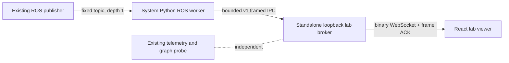

# Native ROS2 camera laboratory worker — Phase B

The standalone lab now offers explicit Synthetic and Native ROS2 modes. Native is **not** a deployment: pressing Start launches `prototype/camera_lab/native_worker.py` under `/usr/bin/python3`; the FastAPI broker remains in the isolated venv and imports no `rclpy`, sensor messages or vendor packages. There is no camera capture launch and no synthetic fallback after native errors. The existing telemetry collector, graph probe and production service are unchanged. Only an already running publisher can provide images.

The worker uses `rclpy.init(args=["--ros-args", "--disable-external-lib-logs"])`, no ROS out, no parameter services and a best-effort KEEP_LAST depth-one subscription. This preserves the known read-only-home logging compatibility approach. Source ROS environment must be supplied to the lab process; no DDS or domain changes are made. RDK native `rclpy` and `sensor_msgs` are required in system Python. Conversion uses the Python standard library, not a new pip, OpenCV or vendor dependency. The broker uses its existing FastAPI/Uvicorn dependencies. Actual device QoS compatibility is unknown; best effort must be checked against the publisher in a separately approved physical test.

Fixed choices: left `/image_left_raw` and its camera_info; right `/image_right_raw` and its camera_info; combined `/image_combine_raw` plus left/right combined camera_info. Combined compressed mode selects `/image_combine_jpeg`; raw is default. These are historical names, not proof of publishers or actual message types. No arbitrary topic names can be supplied through the UI or worker CLI. At most one native worker exists at once; synthetic clients stay separate. Each worker subscribes to its selected image and one or two matching calibration topics, stopping on viewer disconnect, switch, stop, startup failure, IPC timeout or crash. No subscription runs in inactive mode.

Calibration shown in the viewer is the received topic's dimensions, distortion model, K and D and calibrated/uncalibrated status; malformed/non-finite or oversize calibration is rejected. Metadata is available only after a `CameraInfo` callback and is carried with a later image. No synthetic calibration is fabricated. Frame age begins at broker receipt and is not end-to-end capture latency; original ROS header stamp is carried in metadata but not assumed to share a wall clock. The UI shows worker RSS and CPU separately from lab process metrics when readable from local `/proc`.

See [encoding compatibility](CAMERA_ENCODING_COMPATIBILITY.md), [protocol](CAMERA_IPC_PROTOCOL.md), [lifecycle](CAMERA_WORKER_LIFECYCLE.md), and [physical procedure](CAMERA_PHYSICAL_LAB_PROCEDURE.md). Actual RDK testing, ROS types/encoding and resource envelope remain unverified.

B.1 workstation-only correction: after physical metadata identified NV12 1088×1280, and the user approved local work, the worker can generate an explicitly labelled grayscale luminance preview from the NV12 Y plane. The NV12 height cap is now 1280; existing raw-byte and IPC caps remain unchanged. This is not a color preview and has not yet been physically exercised. The original transferred Phase B bundle predates this correction.
