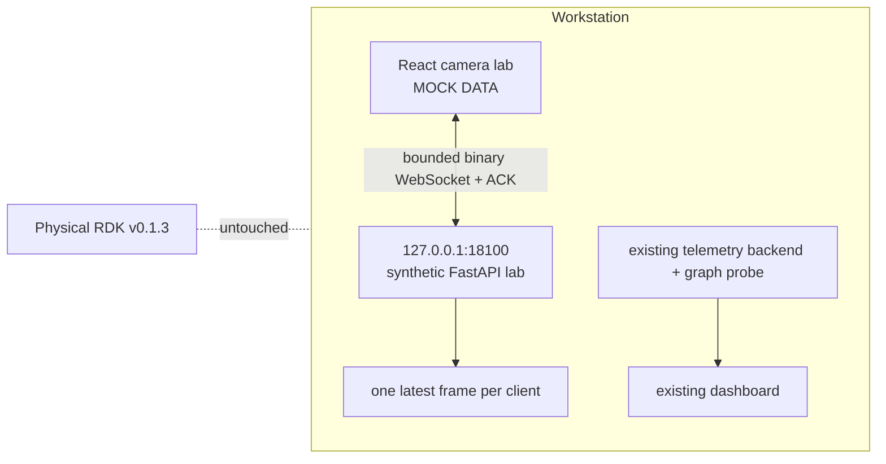
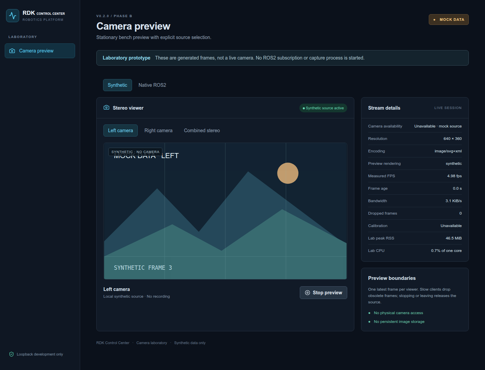
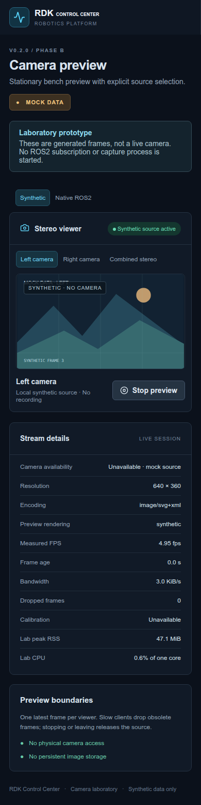

# v0.2.0 Phase A architecture

Phase A is a **standalone synthetic-only laboratory**, not a release or a physical camera integration. It leaves the existing backend, graph discovery, Nginx and active target installation unchanged. The prototype uses a separate loopback-only FastAPI process and standalone React/TypeScript page, with no ROS package or vendor driver import. Its Start button creates a synthetic source; Stop/disconnect destroys it. No image bytes are saved by the process. Screenshots in this document are deliberately recorded mock evidence.



```mermaid
sequenceDiagram
  participant U as User / browser
  participant L as Synthetic lab
  U->>L: Start / select view, open WebSocket
  L->>L: Start one producer; replace latest slot at 5 fps
  L-->>U: metadata + one binary frame
  U->>L: ACK after image decode
  Note over L: If slow, newest replaces old; ACK deadline 2 s
  U->>L: Stop, switch, close or disconnect
  L->>L: Cancel producer, clear client slot
```

The selected transport, alternatives and caveats are in [transport comparison](CAMERA_TRANSPORT_COMPARISON.md); design for a future **separate `/usr/bin/python3` ROS worker** is in [worker design](CAMERA_WORKER_DESIGN.md). The development viewer displays source state, resolution, encoding, delivered FPS, receive age, payload bandwidth and dropped frames. Camera availability and calibration are unavailable in this synthetic-only implementation; they are not fabricated. The screen labels all images MOCK DATA. Its dropped count is per-client skipped synthetic sequence numbers; FPS is delivered frames/time and bandwidth is sent image bytes/time, not capture rate or full network throughput.




## Planned migration, not implemented

A future v0.1.3 → v0.2.0 migration must add version-specific preparation/activation and rollback target v0.1.3, preserve all historical transaction paths, resolve `.deployment/active.json` rather than use an old base Compose file, and back up current source/venv, generated configuration, unit/drop-ins and image. Preview must be disabled by default until its service isolation and compatibility are reviewed. Do not alter the physical installation in Phase A. Physical rollback for v0.1.x has not been tested; no rollback for v0.2.0 exists or is claimed.
